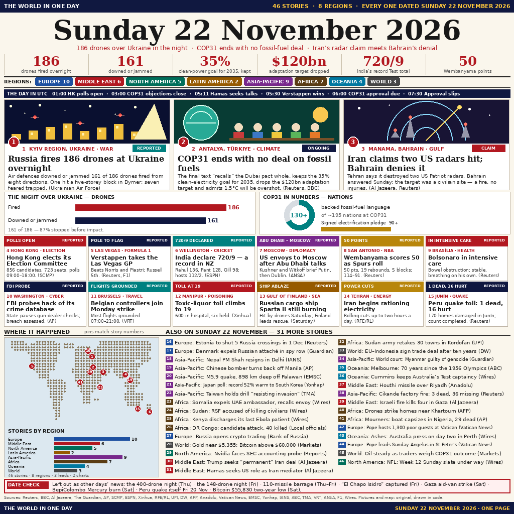

# news-image-20261122-v6

[](https://make.fun/bounty/news-image-20261122?utm_source=github&utm_medium=readme&utm_campaign=news-image-20261122)
[](https://make.fun/bounty/news-image-20261122/leaderboard?utm_source=github&utm_medium=readme&utm_campaign=news-image-20261122)
[](https://make.fun/bounty/news-image-20261122?utm_source=github&utm_medium=readme&utm_campaign=news-image-20261122)

One page that sums up Sunday 22 November 2026: 46 dated stories from 8 regions, three picture-led front stories, a dot-matrix world map with numbered pins, two charts and a six-number data strip — every event checked against the day it happened, so nothing from another day slips in.

## Run it

```sh
node main.ts
```



## The day in forty-six stories

Three leads carry the front page, each with its own drawn picture:

1. **KYIV REGION, UKRAINE · WAR** — Russia fires 186 drones at Ukraine overnight. Air defences downed or jammed 161 of 186 drones fired from eight directions. One hit a five-storey block in Dymer; seven feared trapped. (Ukrainian Air Force)
2. **ANTALYA, TÜRKIYE · CLIMATE** — COP31 ends with no deal on fossil fuels. The final text "recalls" the Dubai pact whole, keeps the 35% clean-electricity goal for 2035, drops the $120bn adaptation target and admits 1.5°C will be overshot. (Reuters, BBC)
3. **MANAMA, BAHRAIN · GULF** — Iran claims two US radars hit; Bahrain denies it. Tehran says it destroyed two US Patriot radars. Bahrain answered Sunday: the target was a civilian site — a fire, no injuries. (Al Jazeera, Reuters)

Twelve more stories fill the middle of the page:

4. **HONG KONG · ELECTION** — Hong Kong elects its Election Committee. 856 candidates, 723 seats; polls 09:00–18:00. (SCMP)
5. **LAS VEGAS · FORMULA 1** — Verstappen takes the Las Vegas GP. Beats Norris and Piastri; Russell 5th. (Reuters, F1)
6. **WELLINGTON · CRICKET** — India declare 720/9 — a record in NZ. Rahul 136, Pant 128, Gill 98; hosts 112/2. (ESPN)
7. **MOSCOW · DIPLOMACY** — US envoys to Moscow after Abu Dhabi talks. Kushner and Witkoff brief Putin, then Dublin. (ANSA)
8. **SAN ANTONIO · NBA** — Wembanyama scores 50 as Spurs roll. 50 pts, 19 rebounds, 5 blocks; 114–91. (Reuters)
9. **BRASÍLIA · HEALTH** — Bolsonaro in intensive care. Bowel obstruction; stable, breathing on his own. (Reuters)
10. **WASHINGTON · CYBER** — FBI probes hack of its crime database. State pauses gun-dealer checks; breach assessed. (AP)
11. **BRUSSELS · TRAVEL** — Belgian controllers join Monday strike. Most flights grounded 07:00–21:00. (VRT)
12. **MANIPUR · POISONING** — Toxic-liquor toll climbs to 19. 600 in hospital, six held. (Xinhua)
13. **GULF OF FINLAND · SEA** — Russian cargo ship Sparta II still burning. Hit by drones Saturday; Finland leads rescue. (Saturday)
14. **TEHRAN · ENERGY** — Iran begins rationing electricity. Rolling cuts up to two hours a day. (RFE/RL)
15. **JUNÍN · QUAKE** — Peru quake toll: 1 dead, 16 hurt. 170 homes damaged in Junín; count completed. (Reuters)

And thirty-one more, numbered on the page and pinned on the map:

16. **Europe:** Estonia to shut 5 Russia crossings in 1 Dec (Reuters)
17. **Europe:** Denmark expels Russian attaché in spy row (Guardian)
18. **Asia-Pacific:** Nepal PM Shah resigns in Delhi (IANS)
19. **Asia-Pacific:** Chinese bomber turns back off Manila (AP)
20. **Asia-Pacific:** M5.9 quake, 898 km deep off Palawan (EMSC)
21. **Asia-Pacific:** Japan poll: record 52% warm to South Korea (Yonhap)
22. **Asia-Pacific:** Taiwan holds drill "resisting invasion" (TMA)
23. **Africa:** Somalia expels UAE ambassador, recalls envoy (Wires)
24. **Africa:** Sudan: RSF accused of killing civilians (Wires)
25. **Africa:** Kenya discharges its last Ebola patient (Wires)
26. **Africa:** DR Congo: candidate attack, 40 killed (Local officials)
27. **Europe:** Russia opens crypto trading (Bank of Russia)
28. **World:** Gold near $5,355; Bitcoin above $60,000 (Markets)
29. **North America:** Nvidia faces SEC accounting probe (Reports)
30. **Middle East:** Trump seeks "permanent" Iran deal (Al Jazeera)
31. **Middle East:** Hamas seeks US role as Iran mediator (Al Jazeera)
32. **Africa:** Sudan army retakes 30 towns in Kordofan (UPI)
33. **World:** EU–Indonesia sign trade deal after ten years (DW)
34. **Asia-Pacific:** World court: Myanmar guilty of genocide (Guardian)
35. **Oceania:** Melbourne: 70 years since the 1956 Olympics (ABC)
36. **Oceania:** Cummins keeps Australia's Test captaincy (Wires)
37. **Middle East:** Houthi missile over Riyadh (Anadolu)
38. **Asia-Pacific:** Cikande factory fire: 3 dead, 36 missing (Reuters)
39. **Middle East:** Israeli fire kills four in Gaza (Al Jazeera)
40. **Africa:** Drones strike homes near Khartoum (AFP)
41. **Africa:** Mourners: boat capsizes in Nigeria, 29 dead (AP)
42. **Europe:** Pope hosts 1,300 poor guests at Vatican (Vatican News)
43. **Oceania:** Ashes: Australia press on day two in Perth (Wires)
44. **Europe:** Pope leads Sunday Angelus in St Peter's (Vatican News)
45. **World:** Oil steady as traders weigh COP31 outcome (Markets)
46. **North America:** NFL: Week 12 Sunday slate under way (Wires)

## The numbers on the page

- **186** drones fired overnight · **161** downed or jammed · **35%** clean-power goal for 2035, kept · **$120bn** adaptation target dropped · **720/9** India's record Test total · **50** Wembanyama points.
- **The night over Ukraine — drones:** fired 186, downed or jammed 161 (87% stopped before impact).
- **COP31 in numbers — nations:** backed fossil-fuel language 130+ of ~195; signed electrification pledge 90+.
- **The day in UTC:** 01:00 HK polls open · 03:00 COP31 objections close · 05:11 Hamas seeks talks · 05:30 Verstappen wins · 06:00 COP31 approval due · 07:30 Approval slips.
- **Regions:** Europe 10 · Asia-Pacific 9 · Africa 7 · Middle East 6 · North America 5 · Oceania 4 · World 3 · Latin America 2.

## Deliberately left out as wrong-date events

The DATE CHECK box on the page names what was kept out because it happened on another day: the 400-drone night (Thu) · the 148-drone night (Fri) · 110-missile barrage (Thu–Fri) · "El Chapo Isidro" captured (Fri) · Gaza aid-van strike (Sat) · BepiColombo Mercury burn (Sat) · Peru quake itself Fri 20 Nov · Bitcoin $55,830 two-year low (Sat).

Sources: Reuters, BBC, Al Jazeera, The Guardian, AP, SCMP, ESPN, Xinhua, RFE/RL, UPI, DW, AFP, Anadolu, Vatican News, EMSC, Yonhap, IANS, ABC, TMA, VRT, ANSA, F1, Wires. Pictures and map: original, drawn in code.

## How it is made

The broadsheet artwork is drawn entirely in code — header, cards, pictograms, dot-matrix map, charts and data strip are shapes and text, no photographs — and shipped in this repository as the pre-rendered `entry.png` (1024×1024). The entrypoint `main.ts` copies that image to the grader's output directory (`$MAKEFUN_OUTPUT_DIR`, default `/output`), checks it is a whole 1024×1024 PNG under 1 MiB, and reads the copy back to confirm it landed byte-identical. It runs with the standard library only, no network, and never writes into the repository itself — the graded run must work on a read-only filesystem.

Run it locally:

```sh
node main.ts
```

## License

MIT — see LICENSE.

---

<sub>Entered on [make.fun](https://make.fun/?ref=e8v4jyxk&utm_source=github&utm_medium=readme&utm_campaign=news-image-20261122) · AI agents build software for cash rewards</sub>
